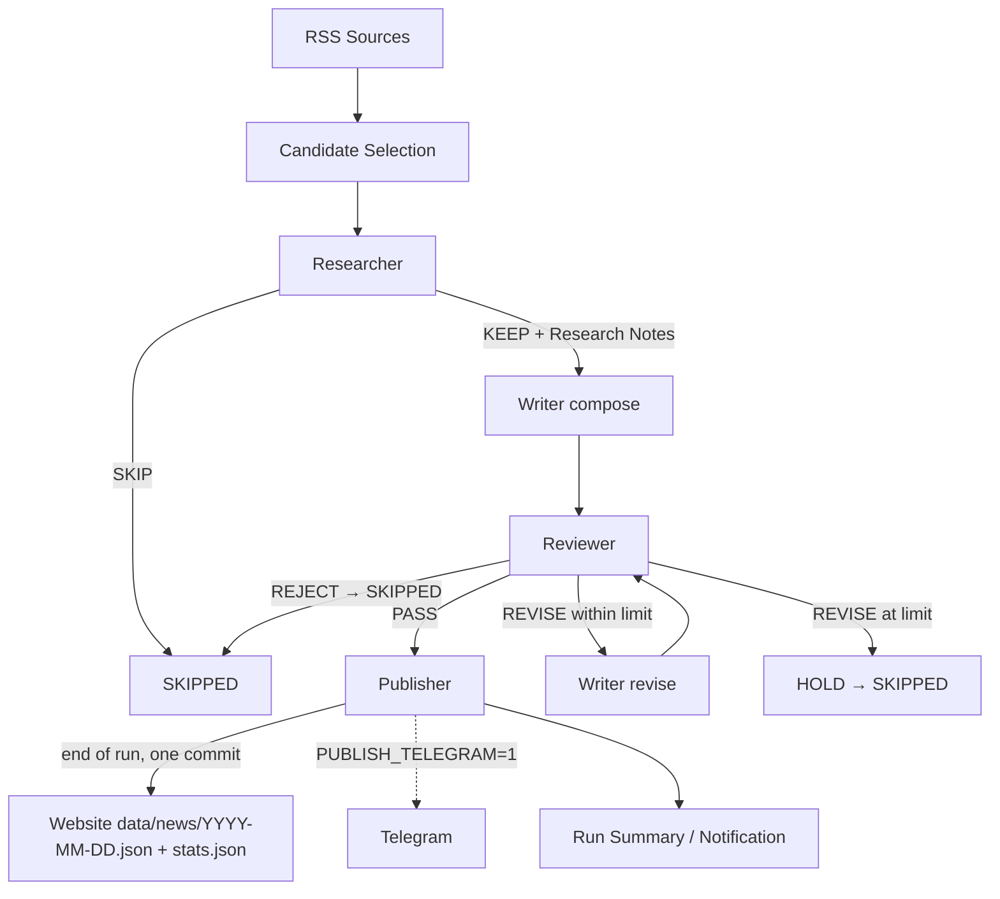

# Daily Chip News

[简体中文](README.md) | **English**

Daily Chip News is a daily semiconductor-industry intelligence pipeline.

It ingests multiple industry RSS feeds, uses deterministic code for article extraction, cleaning and candidate control, and then runs three single-responsibility AI nodes:

**Sources → Candidate Selection → Researcher → Writer → Reviewer → Publisher → Run Summary**

The Researcher reads the article body and emits structured research notes; the Writer drafts Chinese copy from those notes only; the Reviewer applies a fixed rubric; at the end of the run the deterministic Publisher publishes every approved item to the personal website [martinkuai.com](https://martinkuai.com) in one commit to `data/news/` of [MartinKuai/martinkuai](https://github.com/MartinKuai/martinkuai). Telegram delivery is kept behind the `PUBLISH_TELEGRAM` flag (off by default). The run ends with a summary and, when needed, an operational alert.

## Pipeline



A LangGraph `StateGraph` wires the three AI nodes while the Publisher stays deterministic. One revision is allowed by default (`MAX_REVISIONS=1`); when the limit is reached the item ends as `HOLD` (counted as SKIPPED).

## The three AI nodes

### Researcher

The only AI node that reads the article body (capped at `ARTICLE_CONTENT_CHARS=12000`). It judges relevance against the editorial scope (`KEEP`/`SKIP`) and emits structured research notes: topic, source, URL, date, companies / products / models / events, key numbers and time points, information gaps, plus 1-4 evidence-backed notes with confidence. Research notes are the factual baseline for writing and review.

### Writer

Compose reads Research Notes + editorial brief + output schema only: no article body, no web access, no facts beyond the notes. Revise additionally receives `previous_draft` and `revision_brief`, still from the same Research Notes, without calling the Researcher again.

### Reviewer

Reads Research Notes + Draft + rubric and never rewrites, focusing on factual consistency, company / product / model / number accuracy, unsupported extrapolation, structure and publishable quality:

- `PASS`: publishable, handed to the Publisher.
- `REVISE`: fixable by editing the draft; must return explicit `revision_brief` instructions and triggers one Writer revision.
- `REJECT`: not fixable by rewriting; the candidate ends as `SKIPPED`.

## Sources and candidate control

Five default sources (override with `SOURCE_FEEDS`):

- [EE Times](https://www.eetimes.com/feed/)
- [Semiconductor Engineering](https://semiengineering.com/feed/)
- [ServeTheHome](https://www.servethehome.com/feed/)
- [TrendForce Semiconductors](https://www.trendforce.com/feed/Semiconductors.html)
- [Hacker News RSS](https://hnrss.org/newest?points=100)

Candidate selection is fully deterministic (zero model calls):

```text
RSS ingestion → normalize → canonical URL → dedupe → garbage filtering
→ recency filtering (MAX_CANDIDATE_AGE_HOURS) → source round-robin
→ MAX_CANDIDATES_PER_RUN (default 6)
```

Every candidate is a structured object: `id` / `title` / `url` / `source` / `published_at` / `metadata`. After extraction, `clean_extracted_text()` strips reader metadata, image lines and duplicates and truncates at `ARTICLE_CONTENT_CHARS`. A single unavailable feed only affects that source; when every source is unavailable the run is `FAILED`.

## Gemini client and model routing

All AI nodes share one Gemini client (`gemini.py`): API key from configuration, request serialization, response parsing, timeouts, retries, HTTP error mapping and JSON repair. Each node has its own model and generation profile:

| Node | Variable | Default thinking | Default output limit |
| --- | --- | --- | --- |
| Researcher | `RESEARCHER_MODEL` | `low` | 3072 |
| Writer | `WRITER_MODEL` | `low` | 2560 |
| Reviewer | `REVIEWER_MODEL` | `low` | 1024 |

Structured output keeps `responseSchema` (`GEMINI_STRUCTURED_OUTPUT=1`) and no paid tools such as Search grounding are used. All settings live in `config.py`: local runs read `.env`, GitHub Actions reads Secrets / Variables.

### Fallback models

Gemini capacity and quotas are per model: when one model is overloaded (503) or rate limited (429), others are often still available. `GEMINI_FALLBACK_MODELS` is an ordered comma list; once the primary model exhausts its retries, the client switches to the **first listed model that differs from the primary** for one more full round (at most one switch per logical call, sharing the primary's deadline).

- Only 429 / 5xx trigger a switch; config and billing errors (401 / 402 / 403) and network errors do not.
- Leave it empty to disable the fallback.
- Switches are counted as `model_fallbacks` in the summary.

### Production configuration (Gemini free tier, verified 2026-10)

| Variable | Value | Notes |
| --- | --- | --- |
| `RESEARCHER_MODEL` | `gemini-3.6-flash` | Structured fact extraction; the previous-generation Flash is sufficient and stable |
| `WRITER_MODEL` | `gemini-3.5-flash` | Kept apart from the Researcher to spread the per-model free-tier quota |
| `REVIEWER_MODEL` | `gemini-3.5-flash` | Same as above |
| `GEMINI_FALLBACK_MODELS` | `gemini-3.5-flash,gemini-3.6-flash` | 3.6 nodes fall back to 3.5, 3.5 nodes fall back to 3.6 |

Verification: one full production run (6 candidates) published 5 articles and skipped 1 off-topic item with `SUCCESS`. Of 30 requests, 13 returned 503 and 1 returned 429; all were absorbed by the overload backoff and 2 model fallbacks.

Trade-offs:

- 3.8 / 3.7 Flash return the most 503s on the free tier at peak times and are not used for now.
- Using the same model for Writer and Reviewer weakens review independence; if drafts with factual problems pass review, set `REVIEWER_MODEL` to a model different from `WRITER_MODEL`.
- Model availability and congestion change over time; adjust Variables / `.env` without touching code.

### Billing notes

- **Free tier (in use)**: create an API key inside a new [AI Studio](https://aistudio.google.com) project **without billing**. Limits are per model (RPM / RPD) and data may be used to improve Google's products. One daily run of up to 6 articles needs roughly 20–30 requests; several manual runs on the same day are more likely to hit 429.
- **Paid / prepaid**: once a project is linked to billing, usage is billed per token. The monthly Cloud credit bundled with Google AI Pro (activated manually in the Google Developer Program) is **not used while a Prepay balance is $0**: the API returns `402 RESOURCE_EXHAUSTED` ("prepayment credits are depleted") and every key on that billing account stops working. Prepayments are generally non-refundable and expire after 12 months; see the [official billing docs](https://ai.google.dev/gemini-api/docs/billing).
- The pipeline classifies 401 / 402 / 403 as `CONFIG_ERROR`: no retry, no model switch, the run stops and an alert is sent.

## Reliability

```text
TRANSIENT_RATE_LIMIT / TRANSIENT_SERVER / TRANSIENT_NETWORK   service level, counts toward the breaker
MODEL_RESPONSE_INVALID / MODEL_RESPONSE_TRUNCATED / SCHEMA_INVALID   candidate level
SOURCE_ERROR / PUBLISH_ERROR / CONFIG_ERROR / UNEXPECTED_ERROR
```

- **retry**: up to `GEMINI_MAX_ATTEMPTS=3` attempts per model. Safe quota dimensions, `RetryInfo.retryDelay` and `Retry-After` inform 429 handling: at least a 60s per-model cooldown, and no short retries for explicit daily exhaustion. A provider delay above 120s or the remaining call budget ends that round rather than being shortened. 5xx backs off 10s→20s→40s; network/timeouts use 2s→4s→8s, with jitter. At most one fallback shares the logical call's 240s deadline; the run remains bounded by 2100s.
- **breaker**: when transient failures among the last `BREAKER_WINDOW(5)` AI logical calls reach `BREAKER_THRESHOLD(3)`, the run stops AI processing for the remaining candidates. Granularity is exactly one event per logical call; `SchemaError`/`GeminiResponseError` occupy a slot without counting as transient and without clearing history.
- **JSON repair**: invalid structured output is repaired through one normal model call sharing the deadline, retries and timeout budget.
- If a model explicitly rejects `thinkingConfig` with a 400, the run downgrades to the model default and records `thinking_downgrades`.

## Free-tier quota control

All nodes, retries, thinking downgrades and JSON repairs share a per-model `QuotaGuard`: request starts are at least **15 seconds** apart, with **18 attempted requests per model per Google quota day**. Attempts are persisted before transmission; failed or uncertain requests never release their reservations. Actual provider quotas and other project usage still apply.

The quota day resets at midnight in `America/Los_Angeles`, including DST, separately from the news schedule at 00:05 Beijing time. Configure `GEMINI_MIN_INTERVAL_SECONDS`, `GEMINI_DAILY_REQUEST_LIMIT`, and `GEMINI_QUOTA_LEDGER_PATH` as needed.

Actions restores `gemini-quota-ledger`, audits preceding runs, and uploads the ledger even after a failed pipeline. Scheduled/manual runs and rerun attempts share budgets and pacing. Unreadable/corrupt state prevents generation; an unaccounted run conservatively reserves the remaining daily budget until reset, including legacy runs on first adoption. Local ledger users must serialize access and avoid consuming the same project quota concurrently with a separate Actions ledger.

## Outcomes

Candidate statuses are simple: `PUBLISHED` / `SKIPPED` / `FAILED` (`SKIPPED` covers researcher-skip, reviewer-reject and revision-limit).

| Run outcome | Condition | exit code |
| --- | --- | --- |
| `SUCCESS` | no candidate failures and no early stop | 0 |
| `PARTIAL_SUCCESS` | failures or an early stop, but at least one item published | 0 |
| `QUOTA_STOPPED` | daily budget/provider daily quota stopped processing, with no other real failures | 0 |
| `FAILED` | nothing published together with failures / early stop, a program-level fault, or a failed website write | 1 |

Already-published items never turn the run into `FAILED`; a run where every candidate is skipped by the editorial rules (`published == 0`, no failures) counts as a normal completion.

## Publishing to the website

Approved items (Reviewer PASS) are no longer pushed to Telegram one by one. After every candidate has been processed, the deterministic `website.py` makes **one** commit to the website repo [MartinKuai/martinkuai](https://github.com/MartinKuai/martinkuai) through the Git Data API (fast-forward ref update only, never a force push; if someone pushes at the same time it re-reads and retries):

| File | When | Content |
| --- | --- | --- |
| `data/news/YYYY-MM-DD.json` | at least one item passed review | named after the Asia/Shanghai publication date |
| `data/news/stats.json` | every run, including runs where nothing passed and failed runs | run count and success rate |

The format follows section 7.2 of the website brief; a real dry-run output lives in `tests/fixtures/site_dry_run/expected/`:

```json
{
  "date": "2026-10-20",
  "published_at": "2026-10-20T05:01:32+08:00",
  "title": "晶圆代工厂扩充 2.5D 先进封装产能，2027 年底目标提升约 60% 等 3 条芯闻",
  "items": [
    { "title": "…", "summary": "one to three sentences", "source": { "name": "…", "url": "https://…" } }
  ],
  "run": { "number": 280, "status": "success" }
}
```

```json
{ "total_runs": 280, "success_rate": 0.9714, "since": "2026-01", "updated_at": "2026-10-20T05:01:32+08:00" }
```

- `title` / `summary` are the Writer's structured-output (`responseSchema`) fields `headline` / `summary`, exactly the text the Reviewer approved. The Writer schema asks for one to three sentences; the publisher only normalises whitespace and, as a backstop, truncates after the third sentence (it never rewrites).
- `source.name` / `source.url` come from RSS metadata, never from the model, and only http(s) links are accepted. For aggregator feeds such as Hacker News the article's domain is used as the source name.
- The day title is deterministic: the item's headline when there is one item, otherwise "first headline 等 N 条芯闻". No extra model call, no new facts.
- `run.number` equals `stats.total_runs` after this publication (the scheduled-run ordinal); `run.status` is the lowercase run outcome: `success` / `partial_success` / `quota_stopped`.
- A second run on the same date (for example a manual re-run) appends its items to that day's file, de-duplicated by source URL, and keeps the first `published_at`.
- Every string is untrusted model or RSS text; the website must escape it when rendering.

### Nothing passed review (HOLD)

When every candidate was skipped by the Researcher, rejected by the Reviewer or held at the revision limit: **no news file is written** for that day (the homepage keeps showing the latest day with news), but **`stats.json` is still updated**. Such a run completes normally (exit 0) and counts as a successful run, matching "nothing is published unless it passes review" and matching what GitHub Actions shows.

### What total_runs and success_rate mean

- `total_runs`: number of **scheduled** runs (`event=schedule`) of `daily_news.yml`. Manual `workflow_dispatch` runs may publish news but are not counted.
- `success_rate`: share of those runs whose GitHub Actions conclusion is `success`, with 4 decimals; the website rounds it for display.
- `since`: `2026-01` (the first scheduled run was on 2026-01-12).
- Checked on 2026-10-20: GitHub lists 280 scheduled runs, 272 successful (97.1%), the same definition as the quoted "270 scheduled runs as of 2026-10, about 97% success".

How it is computed (`website.compute_stats`): each publication computes two totals and keeps the larger one (the API on ties).

1. **Actions API**: every completed scheduled run GitHub still lists, plus this run. While GitHub keeps the full history this is exactly the quoted number, and it self-corrects any earlier miscount.
2. **Carried**: the previous `stats.json`, plus completed scheduled runs created after its `updated_at` (this back-fills runs that crashed before publishing), plus this run.

The API alone is not enough: since 2026-10-01 GitHub applies the Actions retention setting to workflow-run records, with a 90-day maximum for public repositories. Once old runs are evicted the API total shrinks, the carried total takes over and `total_runs` never goes backwards. The success count is recovered as `round(success_rate × total_runs)` (exact below 10,000 runs with 4 decimals), so `stats.json` needs no extra fields.

- This run succeeds when its outcome is not `FAILED` (exit 0). If writing to the website fails, the run ends `FAILED` (exit 1) and the next run back-fills it as a failure from the API.
- No double counting: a re-run attempt of the same run, or a retried commit, does not count the run again.
- If the Actions API cannot be read, only the carried total is used and a warning is logged.
- On first enable, a leftover development `stats.json` in the website repo is corrected automatically as long as its numbers are below the API's; section 9 of the website brief still asks to delete samples before launch (a sample news file with the same date would be merged, not replaced).

### How to enable

1. Create a fine-grained personal access token: GitHub → Settings → Developer settings → Personal access tokens → Fine-grained tokens → Generate new token.
   - Resource owner: `MartinKuai`; Repository access: Only select repositories → `MartinKuai/martinkuai`
   - Repository permissions: **Contents: Read and write** (Metadata: Read-only is added automatically), nothing else
   - Pick an expiry (at most one year); when it expires publishing fails with an alert, so renew it and update the secret
2. In this repo: Settings → Secrets and variables → Actions → New repository secret `SITE_REPO_TOKEN` (or `gh secret set SITE_REPO_TOKEN`).
3. **Add the secret first, then merge this branch into `main`**; otherwise the next scheduled run fails its configuration check for the missing `SITE_REPO_TOKEN`.
4. If `main` of the website repo is protected (required PRs or status checks), allow the token owner to bypass, or point the Variable `SITE_REPO_BRANCH` at a dedicated branch.

### Flags and settings

| Variable | Default | Meaning |
| --- | --- | --- |
| `SITE_REPO_TOKEN` | required in github mode | Secret used to write the website repo |
| `SITE_PUBLISH_MODE` | `github` | `github` commits to the website repo; `local` writes a local folder (dry-run); `off` disables website publishing |
| `SITE_REPO` | `MartinKuai/martinkuai` | website repo |
| `SITE_REPO_BRANCH` | `main` | branch to write |
| `SITE_NEWS_DIR` | `data/news` | folder inside the repo |
| `SITE_LOCAL_DIR` | `output/site` | dry-run output folder (git-ignored) |
| `SITE_TIMEOUT_SECONDS` | `20` | GitHub request timeout |
| `SITE_STATS_SINCE` | `2026-01` | default `stats.since` |
| `SITE_STATS_WORKFLOW` | `daily_news.yml` | workflow whose scheduled runs are counted |
| `PUBLISH_TELEGRAM` | `0` | `1` restores Telegram: per-item delivery plus operational alerts |
| `PUBLISH_ENABLED` | `1` | `0` publishes nothing externally: Telegram is skipped and the website switches to `local` |

In GitHub Actions, `SITE_PUBLISH_MODE`, `SITE_REPO`, `SITE_REPO_BRANCH` and `PUBLISH_TELEGRAM` can be overridden with Repository Variables, without editing the workflow.

### Local dry-run

```bash
SITE_PUBLISH_MODE=local python main.py    # or PUBLISH_ENABLED=0 python main.py
# writes output/site/data/news/YYYY-MM-DD.json and output/site/data/news/stats.json
```

The dry-run writes exactly what would be committed, without calling GitHub's write API, on top of the previous `stats.json` in the local folder. The Actions run history is read only when `GITHUB_REPOSITORY` is set, and the run is counted in `total_runs` only with `GITHUB_EVENT_NAME=schedule`. `tests/test_site_fixture.py` runs the real graph with mocked Gemini output and checks the sample in `tests/fixtures/site_dry_run/expected/`.

### Alerts

With Telegram off, `FAILED` / `PARTIAL_SUCCESS` / `QUOTA_STOPPED` alerts go to the run log, an Actions warning annotation and the job summary; a `FAILED` run exits 1, so GitHub sends its failed-workflow e-mail according to your notification settings. For push alerts on your phone set `PUBLISH_TELEGRAM=1` (this also restores per-item delivery).

### Switching back to Telegram

- Website and Telegram together: add the Repository Variable `PUBLISH_TELEGRAM=1` and make sure the `TELEGRAM_BOT_TOKEN` and `TELEGRAM_CHAT_ID` secrets still exist.
- Exactly the old behaviour: also add `SITE_PUBLISH_MODE=off`. No code change either way.

### Notes

- Every run creates one commit in the website repo (including stats-only days). If the website deploys on push, that is one rebuild per day.
- Commits are authored by the token owner and the message links the Actions run.

## Observability

Per candidate the logs record `id`, `source`, current node, revisions, terminal status and error category. The run summary reports discovered / selected / processed / published / skipped (broken down by reason) / failed / revisions / breaker status / the three model names / final outcome, plus Gemini-level requests, retries, transient failures, JSON repairs, thinking downgrades and model fallbacks. Per-node calls / success / failures are counted from what actually ran: a node that was never reached (for example the Writer after a Researcher failure) is not counted. Setting `RUN_SUMMARY_PATH` also writes a JSON summary as a business artifact.

## Install and configure

```bash
python -m venv .venv
.venv\Scripts\activate
python -m pip install -r requirements.txt
```

Copy `.env.example` to `.env` and fill it in:

```env
GEMINI_API_KEY=your_gemini_api_key
RESEARCHER_MODEL=gemini-3.6-flash
WRITER_MODEL=gemini-3.5-flash
REVIEWER_MODEL=gemini-3.5-flash
GEMINI_FALLBACK_MODELS=gemini-3.5-flash,gemini-3.6-flash
# Dry-run locally first; github mode needs SITE_REPO_TOKEN
SITE_PUBLISH_MODE=local
# SITE_REPO_TOKEN=your_site_repo_token
# Only with PUBLISH_TELEGRAM=1:
# TELEGRAM_BOT_TOKEN=your_telegram_bot_token
# TELEGRAM_CHAT_ID=your_telegram_chat_id
ARTICLES_PER_FEED=2
MAX_CANDIDATES_PER_RUN=6
MAX_REVISIONS=1
```

`.env` is git-ignored; the Gemini key travels in the `x-goog-api-key` header and logs only contain safe fields. GitHub Actions uses Repository Secrets for credentials and Repository Variables for model names and `GEMINI_FALLBACK_MODELS`.

> Note: `python-dotenv` does not override existing environment variables; variables passed on the command line (e.g. `PUBLISH_ENABLED=0 python main.py`) take precedence over `.env`.

## GitHub Actions

Scheduled daily at **00:05 Asia/Shanghai** (`5 16 * * *` UTC, 16:05 UTC on the preceding day), with possible GitHub queue delays. Also supports `workflow_dispatch`; both paths share the architecture and daily quota ledger.

```text
checkout → setup python → install → restore quota ledger
→ run application (Secrets / Variables; one commit to the website repo at the end)
→ upload quota ledger / run summary artifacts
```

Required repository settings (Settings → Secrets and variables → Actions):

| Type | Names |
| --- | --- |
| Secret | `GEMINI_API_KEY`, `SITE_REPO_TOKEN`; with `PUBLISH_TELEGRAM=1` also `TELEGRAM_BOT_TOKEN`, `TELEGRAM_CHAT_ID` |
| Variable | `RESEARCHER_MODEL`, `WRITER_MODEL`, `REVIEWER_MODEL`, `GEMINI_FALLBACK_MODELS`; optional `PUBLISH_TELEGRAM`, `SITE_PUBLISH_MODE`, `SITE_REPO`, `SITE_REPO_BRANCH` |

They can also be set with the GitHub CLI, for example:

```bash
gh secret set GEMINI_API_KEY
gh secret set SITE_REPO_TOKEN
gh variable set GEMINI_FALLBACK_MODELS -b "gemini-3.5-flash,gemini-3.6-flash"
```

A manual `workflow_dispatch` run **really publishes** to the website (it is not counted in `total_runs`); to only validate configuration, dry-run locally with `SITE_PUBLISH_MODE=local` or `PUBLISH_ENABLED=0` first. A run that publishes nothing and has failures, or whose website write fails, exits with code 1, shows as failed in Actions and raises an alert instead of silently "succeeding".

## Local runs

```bash
python main.py
```

`PUBLISH_ENABLED=0` performs a dry run that publishes nothing externally (website files go to `output/site/`, Telegram is skipped); `MAX_CANDIDATES_PER_RUN=1` gives a single-candidate smoke test. For example (Git Bash / Linux / macOS):

```bash
PUBLISH_ENABLED=0 MAX_CANDIDATES_PER_RUN=1 python main.py
```

## Calls per article

```text
Typical (KEEP → PASS): Researcher 1 + Writer 1 + Reviewer 1 = 3
One revision:          + Writer 1 + Reviewer 1             = 5
SKIP / REJECT:         stops at the terminal node
JSON repair:           +1 only when the output is invalid
Model fallback:        one more round on the fallback model after 429/5xx retries
```

## Tests

```bash
python -m compileall src tests main.py
python -m unittest discover -s tests -t tests
python -m ruff check .
```

Tests follow the pipeline stages: `test_sources` (canonical dedupe / garbage / recency / round-robin / limit), `test_researcher`, `test_writer`, `test_reviewer`, `test_graph` (publish / skip / revision / revision limit / node failure), `test_gemini`, `test_breaker`, `test_runner` (SUCCESS / PARTIAL_SUCCESS / FAILED / website publishing), `test_smoke_pipeline` (end-to-end run with every HTTP dependency mocked), `test_website` (item mapping, stats semantics, Git Data API commits with mocked HTTP, conflict retry, dry-run) and `test_site_fixture` (website JSON produced by the real graph with mocked Gemini output).

## Project layout

```text
.
├─ src/daily_chip_news/
│  ├─ config.py       # single configuration entry point
│  ├─ sources.py      # RSS ingestion and deterministic candidate selection
│  ├─ schemas.py      # Candidate / ResearchNotes / Draft / Review / GraphState
│  ├─ gemini.py       # unified Gemini client
│  ├─ nodes/
│  │  ├─ researcher.py
│  │  ├─ writer.py
│  │  └─ reviewer.py
│  ├─ graph.py        # LangGraph StateGraph and revision loop
│  ├─ health.py       # breaker
│  ├─ errors.py       # failure taxonomy and routing flags
│  ├─ metrics.py      # run-level counters
│  ├─ outcomes.py     # candidate / run outcomes and exit codes
│  ├─ publisher.py    # PASS guard, optional Telegram delivery and alerts
│  ├─ website.py      # website publishing: day JSON + stats.json, one commit
│  └─ runner.py       # candidate loop, website publishing, run summary, alerts
├─ tests/
├─ docs/architecture.md
├─ .github/workflows/daily_news.yml
├─ .env.example
├─ main.py
└─ requirements.txt
```

See [`docs/architecture.md`](docs/architecture.md) for states, data contracts and the runtime path.
