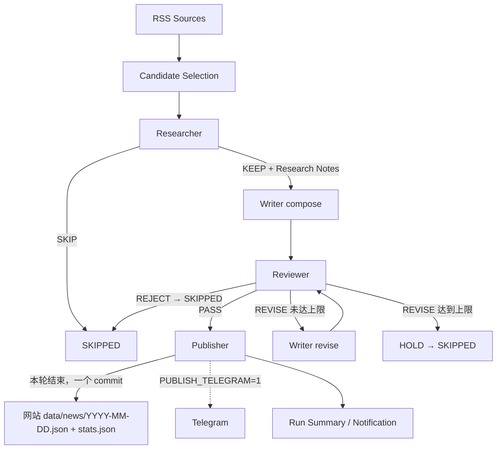

# Daily Chip News

**简体中文** | [English](README.en.md)

Daily Chip News 是一个每日运行的半导体行业情报自动化工作流。

它从多个行业 RSS 获取最新内容，用确定性代码完成正文提取、清洗与候选控制，再交给三个职责独立的 AI 节点处理：

**Sources → Candidate Selection → Researcher → Writer → Reviewer → Publisher → Run Summary**

Researcher 读取正文并输出结构化研究笔记；Writer 只根据研究笔记写中文成稿；Reviewer 按固定标准审核；审核通过的条目在本轮结束时由确定性的 Publisher 一次性发布到个人网站 [martinkuai.com](https://martinkuai.com)（向 [MartinKuai/martinkuai](https://github.com/MartinKuai/martinkuai) 的 `data/news/` 提交一个 commit），Telegram 推送保留为默认关闭的开关 `PUBLISH_TELEGRAM`；最后输出 run summary 与必要的运维告警。

## Pipeline



LangGraph `StateGraph` 编排三个 AI 节点，Publisher 保持确定性。默认最多返工一次（`MAX_REVISIONS=1`），达到上限进入 `HOLD`（计入 SKIPPED）。

## 三个 AI 节点

### Researcher

唯一读取文章正文的 AI 节点，正文输入上限 `ARTICLE_CONTENT_CHARS=12000`。它依据 editorial scope 判断相关性（`KEEP`/`SKIP`），并输出结构化 Research Notes：topic、来源、链接、日期、公司/产品/型号/事件、关键数字与时间、信息缺口（gaps），以及 1-4 条带证据与置信度的事实笔记。Research Notes 是后续写作与审核的**事实基线**。

### Writer

compose 只读取 Research Notes + editorial brief + 输出 schema，看不到正文、不能访问原网页、不得补充笔记之外的事实。revise 时额外接收 `previous_draft` 与 `revision_brief`，仍然使用同一套 Research Notes，不重新调用 Researcher，不改变事实来源。

### Reviewer

只读取 Research Notes + Draft + rubric，只审核不重写，重点检查事实一致性、公司名/产品名/型号/数字准确性、无依据扩写、文章结构与发布质量：

- `PASS`：达到发布质量，交给 Publisher。
- `REVISE`：可通过修改 draft 修好，必须给出明确的 `revision_brief`，触发一次 Writer 返工。
- `REJECT`：无法通过改写修复，候选以 `SKIPPED` 结束。

## 信息来源与候选控制

当前默认从五类来源收集候选文章（可用 `SOURCE_FEEDS` 覆盖）：

- [EE Times](https://www.eetimes.com/feed/)
- [Semiconductor Engineering](https://semiengineering.com/feed/)
- [ServeTheHome](https://www.servethehome.com/feed/)
- [TrendForce Semiconductors](https://www.trendforce.com/feed/Semiconductors.html)
- [Hacker News RSS](https://hnrss.org/newest?points=100)

候选选择完全由确定性代码完成（0 次模型调用）：

```text
RSS ingestion → normalize → canonical URL → dedupe → garbage filtering
→ recency filtering (MAX_CANDIDATE_AGE_HOURS) → source round-robin
→ MAX_CANDIDATES_PER_RUN (默认 6)
```

Candidate 统一为结构化对象：`id` / `title` / `url` / `source` / `published_at` / `metadata`。正文提取后由 `clean_extracted_text()` 去掉 reader 元数据、图片/分隔线、重复行，并按 `ARTICLE_CONTENT_CHARS` 截断。单个 RSS 不可用只影响该来源；所有来源均不可用时本次运行 `FAILED`。

## Gemini Client 与模型路由

所有 AI 节点共用同一个 Gemini client（`gemini.py`）：从配置读取 API Key、序列化请求、解析响应、超时、retry、HTTP 错误映射、JSON repair。每个节点独立配置模型与生成参数：

| 节点 | 变量 | 默认 thinking | 默认输出上限 |
| --- | --- | --- | --- |
| Researcher | `RESEARCHER_MODEL` | `low` | 3072 |
| Writer | `WRITER_MODEL` | `low` | 2560 |
| Reviewer | `REVIEWER_MODEL` | `low` | 1024 |

结构化输出保留 `responseSchema`（`GEMINI_STRUCTURED_OUTPUT=1`），不使用 Search grounding 等付费工具。所有配置项集中在 `config.py`，本地读取 `.env`，GitHub Actions 读取 Secrets / Variables。

### 备用模型（fallback）

Gemini 的容量与配额按模型计算：同一时刻某个模型过载（503）或被限流（429），其他模型往往仍可用。`GEMINI_FALLBACK_MODELS` 是一个按优先级排列的逗号列表，主模型用尽重试后，client 会切换到列表中**第一个与主模型不同**的模型再完整尝试一轮（每次逻辑调用最多切换一次，与主模型共享同一个 deadline）。

- 只对 429 / 5xx 切换；401 / 402 / 403 等配置与计费错误、网络错误不切换。
- 留空即关闭 fallback。
- 切换次数记录在 summary 的 `model_fallbacks`。

### 当前生产配置（Gemini 免费层，2026-10 验证）

| 变量 | 值 | 说明 |
| --- | --- | --- |
| `RESEARCHER_MODEL` | `gemini-3.6-flash` | 结构化事实抽取，上一代 Flash 足够且稳定 |
| `WRITER_MODEL` | `gemini-3.5-flash` | 与 Researcher 分开，分散按模型计算的免费层配额 |
| `REVIEWER_MODEL` | `gemini-3.5-flash` | 同上 |
| `GEMINI_FALLBACK_MODELS` | `gemini-3.5-flash,gemini-3.6-flash` | 3.6 节点退到 3.5，3.5 节点退到 3.6 |

验证结果：一次完整线上运行（6 个候选）发布 5 篇、跳过 1 篇无关内容，`SUCCESS`。30 次请求中出现 13 次 503 与 1 次 429，全部由过载退避与 2 次模型 fallback 消化。

取舍：

- 3.8 / 3.7 Flash 在免费层高峰期 503 最频繁，暂不使用。
- Writer 与 Reviewer 使用同一模型会削弱审稿独立性；若发现带事实问题的稿件通过审核，把 `REVIEWER_MODEL` 改为与 `WRITER_MODEL` 不同的模型。
- 模型可用性与拥堵程度会变化，只需修改 Variables / `.env`，无需改代码。

### 计费说明

- **免费层（当前使用）**：在 [AI Studio](https://aistudio.google.com) 新建一个**不绑定结算**的项目并在其中创建 API Key。按模型限制 RPM / RPD，数据可能被用于改进 Google 产品。每天一次、最多 6 篇的用量约 20–30 次请求；同一天多次手动触发更容易遇到 429。
- **付费 / 预付费**：项目绑定结算后按 token 计费。Google AI Pro 订阅附带的每月 Cloud 抵扣金（需在 Google Developer Program 手动激活）在 **Prepay 账户余额为 0 时不会被使用**：API 直接返回 `402 RESOURCE_EXHAUSTED`（"prepayment credits are depleted"），所有绑定该结算账户的 Key 同时停用。预付款原则上不可退款、12 个月后过期，详见[官方计费文档](https://ai.google.dev/gemini-api/docs/billing)。
- pipeline 将 401 / 402 / 403 归类为 `CONFIG_ERROR`：不重试、不切换模型，立即停止本轮并发送告警。

## 可靠性

```text
TRANSIENT_RATE_LIMIT / TRANSIENT_SERVER / TRANSIENT_NETWORK   服务级，计入熔断
MODEL_RESPONSE_INVALID / MODEL_RESPONSE_TRUNCATED / SCHEMA_INVALID   候选级
SOURCE_ERROR / PUBLISH_ERROR / CONFIG_ERROR / UNEXPECTED_ERROR
```

- **retry**：默认每个模型最多 `GEMINI_MAX_ATTEMPTS=3` 次。429 读取安全的配额类型与 `RetryInfo.retryDelay`，结合 `Retry-After`，同一模型至少冷却 60s；明确的每日配额耗尽不再短重试。超过等待上限 120s 或剩余调用预算时结束本轮，不提前缩短服务端要求的等待。5xx 退避 10s→20s→40s，network / timeout 退避 2s→4s→8s，带 jitter。每次逻辑调用最多切换一次备用模型，同享 240s 调用预算和 2100s 运行预算。
- **breaker**：最近 `BREAKER_WINDOW(5)` 个 AI 逻辑调用中，瞬态失败达到 `BREAKER_THRESHOLD(3)` 即判定服务不可用，终止本轮后续候选的 AI processing。粒度固定为 **1 个 logical call = 1 个事件**；`SchemaError`/`GeminiResponseError` 占位但不计瞬态，也不清空历史。
- **JSON repair**：非法结构化输出会走一次正常的模型调用修复，与主调用共享 deadline、retry 与超时预算。
- 模型 400 明确拒绝 `thinkingConfig` 时，本次运行自动降级为模型默认值并记录 `thinking_downgrades`。

## 免费配额控制

所有 AI 节点、HTTP retry、thinking 降级与 JSON repair 共用按模型计数的 `QuotaGuard`。默认同一模型的请求起点至少间隔 **15 秒**，每个 Google 配额日最多预留 **18 次**请求；失败或结果不确定的请求不返还预留。实际服务端额度以 AI Studio 为准，同一项目的其他调用仍可能占用额度。

`GEMINI_MIN_INTERVAL_SECONDS=15`、`GEMINI_DAILY_REQUEST_LIMIT=18` 可调。Google 每日配额按 `America/Los_Angeles` 午夜重置，跟随夏令时，与北京时间 00:05 的新闻定时不同。

Actions 先恢复 `gemini-quota-ledger` artifact，再执行生成，并在成功或失败后保存账本。发送前原子写入计数；定时、手工运行和同一 run 的重跑共享预算与冷却。无法读取/校验账本时禁止生成；有未保存账本的先前运行时，保守预留当天剩余预算，等待下一个 Google 配额日。首次启用也审计当天旧版本运行，避免重置预算。

本地可通过 `GEMINI_QUOTA_LEDGER_PATH=gemini-quota-ledger.json` 保存账本；本地必须串行，不能与 Actions 的独立账本同时消耗同一项目额度。

## 运行结果

候选级状态只有三种：`PUBLISHED` / `SKIPPED` / `FAILED`（`SKIPPED` 含 researcher-skip、reviewer-reject、revision-limit）。

| Run outcome | 触发条件 | exit code |
| --- | --- | --- |
| `SUCCESS` | 无候选失败，且未因 breaker / 时间预算提前停止 | 0 |
| `PARTIAL_SUCCESS` | 有失败或提前停止，但至少发布了一条 | 0 |
| `QUOTA_STOPPED` | 每日预算/明确日配额主动停止，且没有其他真实失败 | 0 |
| `FAILED` | 未发布任何内容且存在失败 / 提前停止；或程序级故障；或网站写入失败 | 1 |

已发布内容不会因为后续候选失败把 run 重新定义为 `FAILED`；全部候选被编辑规则跳过（`published == 0` 且无失败）视为正常完成。

## 发布到网站

审核通过（Reviewer PASS）的条目不再逐条推送 Telegram，而是在本轮所有候选处理完后，由确定性的 `website.py` 向网站仓库 [MartinKuai/martinkuai](https://github.com/MartinKuai/martinkuai) 提交**一个** commit（Git Data API，只做 fast-forward 更新，不 force push；分支被别人同时推送时重新读取后重试）：

| 文件 | 何时写入 | 内容 |
| --- | --- | --- |
| `data/news/YYYY-MM-DD.json` | 本轮至少一条通过审核 | 以发布时的 Asia/Shanghai 日期命名 |
| `data/news/stats.json` | 每一轮（包括没有内容通过、运行失败） | 运行次数与成功率 |

格式与网站简报 7.2 节一致（真实 dry-run 输出见 `tests/fixtures/site_dry_run/expected/`）：

```json
{
  "date": "2026-10-20",
  "published_at": "2026-10-20T05:01:32+08:00",
  "title": "晶圆代工厂扩充 2.5D 先进封装产能，2027 年底目标提升约 60% 等 3 条芯闻",
  "items": [
    { "title": "…", "summary": "一到三句话", "source": { "name": "…", "url": "https://…" } }
  ],
  "run": { "number": 280, "status": "success" }
}
```

```json
{ "total_runs": 280, "success_rate": 0.9714, "since": "2026-01", "updated_at": "2026-10-20T05:01:32+08:00" }
```

- `title` / `summary` 直接取 Writer 结构化输出（`responseSchema`）里的 `headline` / `summary`，也就是 Reviewer 审核过的文本。Writer 的 schema 要求 summary 为一到三句；发布时只做空白规整，超过三句按句末标点截断（只删不改）。
- `source.name` / `source.url` 来自 RSS 元数据，不由模型生成，只接受 http(s) 链接；Hacker News 这类聚合源用文章网站的域名作来源名。
- 当天总标题用确定性规则生成：一条时就是该条标题，多条时为「第一条标题 等 N 条芯闻」，不额外调用模型、不新增事实。
- `run.number` 等于本次发布后的 `stats.total_runs`（定时运行序号）；`run.status` 是本轮结果的小写形式：`success` / `partial_success` / `quota_stopped`。
- 同一天再次运行（例如手动重跑）会把新条目按原文链接去重后追加到当天文件，保留第一次的 `published_at`。
- 所有字符串都是模型或 RSS 产生的不可信文本，网站渲染时必须转义。

### 没有内容通过审核（HOLD）

所有候选都被 Researcher 跳过、被 Reviewer 拒绝，或在返工上限处 HOLD 时：**不写当天的新闻文件**（网站首页继续显示最近一天的芯闻），**仍然更新 `stats.json`**。这种运行属于按设计正常完成（exit 0），计为成功运行，和“审查不通过就不发布”的说法一致，也和 GitHub Actions 显示的结论一致。

### total_runs 与 success_rate 的口径

- `total_runs`：本工作流 `daily_news.yml` 的**定时**运行（`event=schedule`）次数。手动 `workflow_dispatch` 可以发布新闻，但不计数。
- `success_rate`：其中 GitHub Actions 结论为 `success` 的比例，保留 4 位小数；网站展示时自行取整并加“约”。
- `since`：`2026-01`（第一次定时运行是 2026-01-12）。
- 2026-10-20 核对：GitHub 列出 280 次定时运行、272 次成功（97.1%），与“截至 2026 年 10 月定时运行 270 次，成功率约 97%”是同一口径。

计算方法（`website.compute_stats`）：每次发布同时算两个值，取总数较大的一个（相等时用 API）。

1. **Actions API**：GitHub 仍保留的全部已完成定时运行，加上本轮。GitHub 保留完整历史时，这就是上面引用的数字，并会自动纠正之前的偏差。
2. **累加**：上一份 `stats.json`，加上它的 `updated_at` 之后创建、已完成的定时运行（补记那些在发布前就崩溃的运行），再加上本轮。

只用 API 不够：GitHub 从 2026-10-01 起把 workflow run 记录纳入 Actions 保留期，公开仓库最长 90 天。旧记录被清理后 API 总数会变小，这时累加值接管，`total_runs` 不会倒退。成功次数用 `round(success_rate × total_runs)` 还原（4 位小数在 1 万次以内精确），所以 `stats.json` 不需要额外字段。

- 本轮是否成功：结果不是 `FAILED`（exit 0）就算成功。网站写入失败时本轮以 `FAILED` 结束（exit 1），下一轮会通过 API 把它补记为失败。
- 不重复计数：同一次运行的重跑（re-run attempt）或提交重试不会再计一次。
- 读不到 Actions API（网络问题）时只用累加值，并在日志中提示。
- 首次启用时，网站仓库里如果还留着开发样例 `stats.json`，只要样例数字小于 API 的数字就会被自动纠正；按网站简报第 9 节，上线前仍应删除样例（同一天的样例新闻文件会被合并而不是覆盖）。

### 启用步骤

1. 创建 fine-grained personal access token：GitHub → Settings → Developer settings → Personal access tokens → Fine-grained tokens → Generate new token。
   - Resource owner：`MartinKuai`；Repository access：Only select repositories → `MartinKuai/martinkuai`
   - Repository permissions：**Contents: Read and write**（会自动带上 Metadata: Read-only），其他权限都不要
   - 设置过期时间（最长 1 年）；过期后发布会失败并告警，需要续期后更新 secret
2. 在本仓库 Settings → Secrets and variables → Actions → New repository secret 添加 `SITE_REPO_TOKEN`（或 `gh secret set SITE_REPO_TOKEN`）。
3. **先加 secret，再把本分支合并到 `main`**。否则下一次定时运行会因缺少 `SITE_REPO_TOKEN` 而配置失败。
4. 网站仓库的 `main` 如果开启了分支保护（要求 PR 或状态检查），需要允许 token 所有者绕过，或者用 Variable `SITE_REPO_BRANCH` 改写到专用分支。

### 开关与配置

| 变量 | 默认 | 说明 |
| --- | --- | --- |
| `SITE_REPO_TOKEN` | github 模式必填 | Secret，写网站仓库 |
| `SITE_PUBLISH_MODE` | `github` | `github` 提交到网站仓库；`local` 只写本地文件夹（dry-run）；`off` 不发布到网站 |
| `SITE_REPO` | `MartinKuai/martinkuai` | 网站仓库 |
| `SITE_REPO_BRANCH` | `main` | 写入的分支 |
| `SITE_NEWS_DIR` | `data/news` | 仓库内目录 |
| `SITE_LOCAL_DIR` | `output/site` | dry-run 输出目录（已被 Git 忽略） |
| `SITE_TIMEOUT_SECONDS` | `20` | GitHub 请求超时 |
| `SITE_STATS_SINCE` | `2026-01` | `stats.since` 的默认值 |
| `SITE_STATS_WORKFLOW` | `daily_news.yml` | 统计哪个工作流的定时运行 |
| `PUBLISH_TELEGRAM` | `0` | `1` 恢复 Telegram：逐条推送 + 运维告警 |
| `PUBLISH_ENABLED` | `1` | `0` 表示不对外发布任何内容：Telegram 跳过，网站自动改为 `local` |

GitHub Actions 中 `SITE_PUBLISH_MODE`、`SITE_REPO`、`SITE_REPO_BRANCH`、`PUBLISH_TELEGRAM` 可以直接用 Repository Variables 覆盖，不用改 workflow。

### 本地 dry-run

```bash
SITE_PUBLISH_MODE=local python main.py    # 或 PUBLISH_ENABLED=0 python main.py
# 输出：output/site/data/news/YYYY-MM-DD.json、output/site/data/news/stats.json
```

dry-run 写出的两个文件与线上提交的内容完全相同，只是不调用 GitHub 写接口；它会读取本地目录里上一份 `stats.json`。只有设置了 `GITHUB_REPOSITORY` 才会读取 Actions 运行历史；没有 `GITHUB_EVENT_NAME=schedule` 时本轮不计入 `total_runs`。`tests/test_site_fixture.py` 用 mock 的 Gemini 输出跑真实 graph，校验 `tests/fixtures/site_dry_run/expected/` 里的样例。

### 告警

Telegram 关闭时，`FAILED` / `PARTIAL_SUCCESS` / `QUOTA_STOPPED` 告警写入运行日志、Actions 的 warning 注释和 Job Summary；`FAILED` 运行 exit 1，GitHub 会按通知设置发送失败邮件。需要手机推送告警时设 `PUBLISH_TELEGRAM=1`（会同时恢复逐条推送）。

### 切回 Telegram

- 网站和 Telegram 同时发布：Repository Variables 添加 `PUBLISH_TELEGRAM=1`，并确认 `TELEGRAM_BOT_TOKEN`、`TELEGRAM_CHAT_ID` 两个 secret 仍在。
- 完全回到旧行为：再添加 `SITE_PUBLISH_MODE=off`。都不需要改代码。

### 注意

- 每一轮都会在网站仓库产生一个 commit（包括只更新 `stats.json` 的日子）。如果网站部署绑定了 push 自动构建，每天会触发一次重新构建。
- commit 作者是 token 所有者；commit message 带本次 Actions 运行链接，便于追溯。

## 可观测性

按候选记录：`id`、`source`、当前节点、revision、终态与错误分类。运行结束输出 `Run summary`：discovered / selected / processed / published / skipped（按原因细分）/ failed / revisions / breaker 状态 / 三个模型名 / final outcome，以及 Gemini 层面的 requests / retries / transient failures / JSON repair / thinking downgrades / model fallbacks。各节点的 calls / success / failures 按节点实际执行情况计数：未被执行到的节点（例如 Researcher 失败后的 Writer）不会被计入。设置 `RUN_SUMMARY_PATH` 时可额外写出 JSON summary 作为业务 artifact。

## 安装与配置

```bash
python -m venv .venv
.venv\Scripts\activate
python -m pip install -r requirements.txt
```

复制 `.env.example` 为 `.env` 并填写：

```env
GEMINI_API_KEY=your_gemini_api_key
RESEARCHER_MODEL=gemini-3.6-flash
WRITER_MODEL=gemini-3.5-flash
REVIEWER_MODEL=gemini-3.5-flash
GEMINI_FALLBACK_MODELS=gemini-3.5-flash,gemini-3.6-flash
# 本地先 dry-run；改成 github 时需要 SITE_REPO_TOKEN
SITE_PUBLISH_MODE=local
# SITE_REPO_TOKEN=your_site_repo_token
# PUBLISH_TELEGRAM=1 时才需要：
# TELEGRAM_BOT_TOKEN=your_telegram_bot_token
# TELEGRAM_CHAT_ID=your_telegram_chat_id
ARTICLES_PER_FEED=2
MAX_CANDIDATES_PER_RUN=6
MAX_REVISIONS=1
```

`.env` 已由 Git 忽略；Gemini key 通过 `x-goog-api-key` header 发送，日志与 summary 只输出安全字段。GitHub Actions 的凭证来自 Repository Secrets，模型名与 `GEMINI_FALLBACK_MODELS` 来自 Repository Variables。

> 注意：`python-dotenv` 不会覆盖已存在的环境变量；命令行临时传入的变量（如 `PUBLISH_ENABLED=0 python main.py`）优先于 `.env`。

## GitHub Actions

每天北京时间 **00:05**（`5 16 * * *` UTC，即前一天 16:05 UTC）定时触发，也支持 `workflow_dispatch`。GitHub 调度可能排队延迟；两者共用 application architecture 和每日配额账本。

```text
checkout → setup python → install → restore quota ledger
→ run application（Secrets / Variables；本轮结束时向网站仓库提交一个 commit）
→ upload quota ledger / run summary artifact
```

仓库需要的配置（Settings → Secrets and variables → Actions）：

| 类型 | 名称 |
| --- | --- |
| Secret | `GEMINI_API_KEY`、`SITE_REPO_TOKEN`；`PUBLISH_TELEGRAM=1` 时另需 `TELEGRAM_BOT_TOKEN`、`TELEGRAM_CHAT_ID` |
| Variable | `RESEARCHER_MODEL`、`WRITER_MODEL`、`REVIEWER_MODEL`、`GEMINI_FALLBACK_MODELS`；可选 `PUBLISH_TELEGRAM`、`SITE_PUBLISH_MODE`、`SITE_REPO`、`SITE_REPO_BRANCH` |

也可以用 GitHub CLI 设置，例如：

```bash
gh secret set GEMINI_API_KEY
gh secret set SITE_REPO_TOKEN
gh variable set GEMINI_FALLBACK_MODELS -b "gemini-3.5-flash,gemini-3.6-flash"
```

手动触发 `workflow_dispatch` 会**真实发布**到网站（不计入 `total_runs`）；只想验证配置时，先在本地用 `SITE_PUBLISH_MODE=local` 或 `PUBLISH_ENABLED=0` 做 dry-run。没有发布任何内容且存在失败的运行、以及网站写入失败的运行，会以 exit code 1 结束，Actions 显示为失败并发出告警，不会静默“成功”。

## 本地运行

```bash
python main.py
```

`PUBLISH_ENABLED=0` 可做不对外发布的 dry-run（网站文件写到 `output/site/`，Telegram 跳过）；`MAX_CANDIDATES_PER_RUN=1` 可做单候选 smoke。例如（Git Bash / Linux / macOS）：

```bash
PUBLISH_ENABLED=0 MAX_CANDIDATES_PER_RUN=1 python main.py
```

## 单篇调用次数

```text
典型（KEEP → PASS）：Researcher 1 + Writer 1 + Reviewer 1 = 3 次
一次返工：            + Writer 1 + Reviewer 1            = 5 次
SKIP / REJECT：       仅到终止节点为止
JSON repair：         仅输出非法时 +1 次
模型 fallback：       主模型 429/5xx 重试用尽时，备用模型再试一轮
```

## 测试

```bash
python -m compileall src tests main.py
python -m unittest discover -s tests -t tests
python -m ruff check .
```

测试按 pipeline 阶段组织：`test_sources`（canonical dedupe / garbage / recency / round-robin / limit）、`test_researcher`、`test_writer`、`test_reviewer`、`test_graph`（publish / skip / revision / revision limit / node failure）、`test_gemini`、`test_breaker`、`test_runner`（SUCCESS / PARTIAL_SUCCESS / FAILED / 网站发布）、`test_smoke_pipeline`（全 HTTP mock 的端到端 smoke）、`test_website`（条目映射、stats 口径、mock HTTP 的 Git Data API 提交、冲突重试、dry-run）、`test_site_fixture`（真实 graph + mock Gemini 生成的网站 JSON 样例）。

## 项目结构

```text
.
├─ src/daily_chip_news/
│  ├─ config.py       # 统一配置入口：模型 profile、source、retry、发布、通知
│  ├─ sources.py      # RSS 收集、canonical/dedupe/junk/recency/round-robin/limit
│  ├─ schemas.py      # Candidate / ResearchNotes / Draft / Review / GraphState
│  ├─ gemini.py       # 统一 Gemini client：序列化、retry、解析、JSON repair
│  ├─ nodes/
│  │  ├─ researcher.py
│  │  ├─ writer.py
│  │  └─ reviewer.py
│  ├─ graph.py        # LangGraph StateGraph 与 revision loop
│  ├─ health.py       # breaker
│  ├─ errors.py       # 错误分类与 routing flags
│  ├─ metrics.py      # run 级计数器
│  ├─ outcomes.py     # 候选/运行结果状态机与 exit code
│  ├─ publisher.py    # PASS 守卫与可选的 Telegram 发布、告警
│  ├─ website.py      # 网站发布：当天 JSON + stats.json，一个 commit
│  └─ runner.py       # 候选循环、网站发布、run summary、通知
├─ tests/
├─ docs/architecture.md
├─ .github/workflows/daily_news.yml
├─ .env.example
├─ main.py
└─ requirements.txt
```

状态、数据契约与运行路径详见 [`docs/architecture.md`](docs/architecture.md)。
